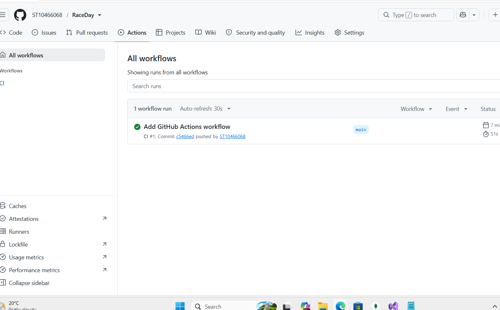

# RaceDay
PROG6212 POE - RaceDay event management system

## About the System
RaceDay is a full-stack web-based event management system built for South Africa's road running, walking, and cycling community. It replaces the paper-based registration and spreadsheet tracking that many local road events still rely on.

Organisers create and manage events, categories and results. Participants browse upcoming events, enrol, and track their personal race history.

## Roles
**Organiser**
- Dashboard with events, enrolments per event and upcoming dates
- Creates, edits and deletes their own events (with a banner image)
- Manages categories, views and confirms enrolments, and publishes results

**Participant**
- Browses and filters upcoming events and views event details
- Enrols in a category, views enrolment status (green Confirmed, amber Pending)
- Views personal results (e.g. 47th out of 312 finishers)
- Updates their profile and uploads a profile picture

Each role has its own navigation. Unauthenticated users cannot reach protected pages, and the wrong role is redirected. Passwords are hashed (BCrypt).

## Repository layout
- `docs/` - Part 1: ERD, endpoint plan, SQL script
- `Part2/` - Part 2: ASP.NET Core Web API and unit tests
- `Part3/` - Part 3: API with Azure Blob Storage, MVC website (`RaceDay.Web`), Dockerfile

## Setup and run locally (Part 3)
1. Install the .NET 9 SDK and Visual Studio 2022.
2. Open `Part3/RaceDay.sln`.
3. Set the SQL connection string and the Blob Storage connection string in `Part3/RaceDay.Api/appsettings.json`.
   - Azure: use your storage account connection string.
   - Local: run the Azurite emulator and keep `UseDevelopmentStorage=true`.
4. In a terminal from `Part3`: `dotnet ef database update --project RaceDay.Api`
5. Set both **RaceDay.Api** and **RaceDay.Web** as startup projects and press F5.
6. API Swagger: `https://localhost:7088/swagger`. Website: opens automatically.

## Run with Docker
Start the API (Visual Studio, http port 5100), then from the `Part3` folder:
```
docker build -t raceday-web .
docker run -p 8080:8080 -e Api__BaseUrl=http://host.docker.internal:5100/ raceday-web
```
Open `http://localhost:8080`.

## Azure Blob Storage
The MVC site never talks to Azure. Images are uploaded to the API (`POST /api/events/{id}/banner` and `POST /api/users/profile/picture`), which stores them in Blob Storage and saves the URL.

## Unit tests
```
cd Part3
dotnet test
```

## CI/CD
GitHub Actions builds Part 2 and Part 3 (including the MVC project) and runs all unit tests on every push.





## Video

https://youtube.com/shorts/b_jKg-FY0rk?si=nTBoiMQl-hOgr44A 
