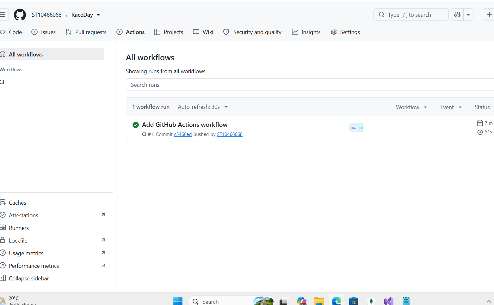

# RaceDay
PROG6212 POE - RaceDay event management system

## About the System
RaceDay is a full-stack web-based event management system built for South Africa's road running, walking, and cycling community. It's designed to replace the paper-based registration and spreadsheet tracking that many local road events still rely on.

The platform allows Event Organisers to create and manage events, categories, and participant results, while Participants can browse upcoming events, enter events, and track their personal performance history.

This repository now contains Part 1 (system planning and database design) and Part 2 (the RESTful API) of the Portfolio of Evidence for PROG6212.

## Roles

**Organiser**
- Creates, edits, and deletes their own events
- Manages event categories (e.g. 5km, 10km, 21km)
- Captures participant results
- Views all enrolments for their events

**Participant**
- Creates an account
- Browses available events
- Enters an event by selecting a category
- Views their own enrolments and results history

Both roles can view events and categories, and view and update their own profile. If a Participant tries to use an Organiser endpoint (or the other way round), the API returns 403 Forbidden. An Organiser also can't change another Organiser's event. Passwords are hashed with BCrypt and never stored in plain text.

## Part 1 Contents
Inside the /docs folder:
- RaceDay_ERD.png: Entity Relationship Diagram for the database
- API_Endpoint_Plan.md: Full API endpoint plan covering authentication, user profile, events, categories, enrolments, and results
- RaceDay_Database.sql: SQL script that creates and seeds the RaceDay database in SSMS

## Part 2 Contents
Inside the /Part2 folder:
- RaceDay.Api: ASP.NET Core Web API (controllers, models, EF Core context and migrations)
- RaceDay.Tests: xUnit tests for the API

Built with ASP.NET Core, Entity Framework Core (code-first), SQL Server, JWT authentication and Swagger.

## Setup and Run
1. Install the .NET 9 SDK and Visual Studio 2022.
2. Clone the repo and open `Part2/RaceDay.sln`.
3. Check the connection string in `Part2/RaceDay.Api/appsettings.json`.
4. Open a terminal in the `Part2` folder and run:
   ```
   dotnet tool install --global dotnet-ef
   dotnet ef database update --project RaceDay.Api
   dotnet run --project RaceDay.Api
   ```
5. Open `https://localhost:7088/swagger` in a browser.
6. Register, log in, click **Authorize** and paste the token (without "Bearer ") to use the protected endpoints.

## Run the Unit Tests
```
cd Part2
dotnet test
```
The tests use an in-memory database, so SQL Server is not needed. They cover registration and login, event management, role rejection, and enrolments.

## CI/CD
GitHub Actions builds the project and runs all the unit tests on every push.





## Video
YouTube (unlisted): _add link here_
